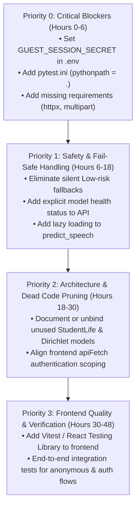

# EmoCare Stabilization Sprint — Phase 1 Repository Audit Report

**Date:** October 28, 2026  
**Repository Branch:** `main`  
**Latest Commit:** `fd29a6a` (*"Remediate security, inference, and clinical safety issues"*)  
**Audit Scope:** Safe, non-destructive baseline audit across FastAPI backend, Next.js frontend, ML models, security, and tests.

---

## 1. Executive Summary & Verification State

- **Baseline Test Suite:** 75 tests implemented across assessment, therapy, auth, and inference.
  - Direct execution via `pytest` fails with `ModuleNotFoundError: No module named 'backend'` (missing package setup / `PYTHONPATH`).
  - Executed via `$env:PYTHONPATH="."; python -m pytest -v`, **all 75 tests pass** (exit code `0`) in 21.11s.
- **Frontend Quality:**
  - TypeScript compilation (`npx tsc --noEmit`) passes cleanly with **0 errors**.
  - ESLint (`npm run lint`) passes with **0 errors, 1 warning** (`@next/next/no-page-custom-font` in `layout.tsx`).
  - Frontend test script (`npm test`) is **missing** from `package.json`.
- **Database & Cloud State (Verified Live):**
  - Project was initially in a paused state on Supabase (`aws-0-ap-south-1.pooler.supabase.com:6543`).
  - Following project unpausing, live connection test succeeded (`SELECT 1`).
  - Verified existing public tables in Supabase PostgreSQL: `assessment_attempts`, `therapy_sessions`, `therapy_messages`, `session_summaries`, `profiles`, `journal_entries`, `voice_checkins`, `messages`.
  - Supabase JWKS endpoint (`https://mycmrvzjeewfsencehrn.supabase.co/auth/v1/.well-known/jwks.json`) is active and responding with public signing keys.

---

## A. Actual Project Structure

```
d:\EmoCare\
├── backend\
│   ├── app\
│   │   ├── engine\
│   │   │   ├── http_pool.py                 # Persistent httpx connection pool for external AI APIs
│   │   │   ├── llm_client.py                # Multi-provider LLM client with tool-calling gating
│   │   │   ├── stt_client.py                # Whisper audio transcription client
│   │   │   ├── therapy_session_manager.py   # Multi-stage dialog state machine & intent engine
│   │   │   ├── tts_client.py                # ElevenLabs voice synthesis client
│   │   │   └── voice_therapy.py             # Parallel audio-in / audio-out voice session manager
│   │   ├── assessment.py                    # Standardized PHQ-9 & GAD-7 scoring & item-9 safety
│   │   ├── auth.py                          # Supabase JWT & guest session token authorization
│   │   ├── db.py                            # SQLite (local) / PostgreSQL (Supabase) data layer
│   │   ├── inference.py                     # Feature extraction & inference for text/speech/survey
│   │   ├── main.py                          # FastAPI application and route endpoints
│   │   ├── model_loader.py                  # Singleton container loading .joblib artifacts
│   │   ├── recommendations.py               # Coping strategies & crisis hotline directory
│   │   ├── safety.py                        # Deterministic crisis and acute distress regex rules
│   │   └── schemas.py                       # Pydantic v2 request/response schemas
│   ├── .env                                 # Backend environment (contains DATABASE_URL)
│   └── requirements.txt                     # Backend-specific Python requirements
│
├── frontend\                                # Next.js 16.3.0 (App Router), React 19, Tailwind v4
│   ├── src\
│   │   ├── app\
│   │   │   ├── assessment\                  # Multi-step clinical assessment (PHQ-9 / GAD-7)
│   │   │   ├── checkin\                     # 7-metric behavioral lifestyle survey check-in
│   │   │   ├── insights\                    # Analytics & distress trends
│   │   │   ├── journal\                     # Text journaling interface
│   │   │   ├── therapy\chat\                # Text therapy session interface
│   │   │   ├── therapy\voice\               # Voice therapy hands-free conversation interface
│   │   │   ├── voice\                       # Standalone audio emotion recorder & visualizer
│   │   │   ├── layout.tsx                   # Root layout (Auth provider, navbar)
│   │   │   └── page.tsx                     # Main dashboard / landing page
│   │   ├── context\                         # AuthContext provider
│   │   ├── lib\                             # api.ts (fetch client) & supabase.ts
│   │   └── types\api.ts                     # TypeScript schemas matching backend Pydantic models
│   ├── .env.local                           # Frontend environment config
│   └── package.json                         # Next.js package configuration
│
├── models\                                  # Trained ML artifacts
│   ├── text_mentalbert\                     # Legacy name: TF-IDF vectorizer + Logistic Regression
│   ├── speech_classifier\                   # 95-feature XGBoost emotion classifier (RAVDESS+CREMA-D)
│   ├── behavioral_classifier\               # Inactive 50-feature StudentLife Random Forest artifact
│   └── fusion_engine\                       # Inactive XGBoost artifact (trained on synthetic Dirichlet)
│
├── tests\                                   # Offline backend test suite (75 test cases)
│   ├── auth_helpers.py                      # Test JWT generation helpers
│   ├── conftest.py                          # Offline test fixture (clears live keys, mocks JWT secrets)
│   ├── test_assessment.py                   # PHQ-9 / GAD-7 tests (17 passed)
│   ├── test_behavioral.py                   # Calibrated lifestyle survey tests (6 passed)
│   ├── test_multimodal.py                   # Late weighted fusion tests (6 passed)
│   ├── test_security_auth.py                # JWT & guest auth / IDOR tests (16 passed)
│   ├── test_speech_features.py              # 95-feature acoustic extraction tests (4 passed)
│   ├── test_text_risk_recall.py             # Asymmetric threshold & safety net tests (5 passed)
│   ├── test_therapy.py                      # Multi-stage dialog & intent tests (14 passed)
│   └── test_voice_therapy_safety.py         # Voice sanitizer & safety tests (7 passed)
│
├── data\                                    # Local datasets & SQLite database (assessments.db)
├── docker\                                  # Dockerfile.api, Dockerfile.frontend, docker-compose.yml
├── notebooks\                               # EDA & experimental training notebooks
├── reports\                                 # ablation_study.csv & ablation_study.json
├── .env                                     # Root backend environment configuration
├── requirements.txt                         # Root Python requirements
└── README.md                                # Project documentation & quickstart
```

---

## B. Exact Startup and Test Commands

### 1. Documented Commands vs. Verified Reality

| Component | Documented Command | Actual Working Command | Verification Status |
| :--- | :--- | :--- | :--- |
| **FastAPI Backend** | `cd backend`<br>`uvicorn app.main:app --reload` | `cd d:\EmoCare\backend`<br>`..\venv\Scripts\uvicorn.exe app.main:app --reload --port 8000` | **Verified working.** Running from `backend/` allows Python to resolve `app.main` without module errors. |
| **Next.js Frontend** | `cd frontend`<br>`npm run dev` | `cd d:\EmoCare\frontend`<br>`npm run dev` | **Verified working.** Starts Next.js development server on `http://localhost:3000`. |
| **Backend Tests** | `pytest` | `$env:PYTHONPATH="."`<br>`& "d:\EmoCare\venv\Scripts\python.exe" -m pytest -v` | **Discrepancy found.** Direct `pytest` fails with `ModuleNotFoundError`. Requires explicit `PYTHONPATH="."`. |
| **Frontend Tests** | *Not documented* | `npm test` | **Missing.** Script `"test"` is not configured in `frontend/package.json`. |
| **Frontend Lint** | *Not documented* | `cd d:\EmoCare\frontend`<br>`npm run lint` | **Verified working.** 0 errors, 1 font warning. |
| **Frontend Types** | *Not documented* | `cd d:\EmoCare\frontend`<br>`npx tsc --noEmit` | **Verified working.** 0 TypeScript errors. |

---

## C. Baseline Test Results

All commands were run against the existing codebase without making modifications:

### 1. Backend Pytest Execution
- **Command:** `& "d:\EmoCare\venv\Scripts\pytest.exe" -v`
  - **Exit Code:** `1`
  - **Output:** Interrupted with **7 collection errors** across all test files:
    `ModuleNotFoundError: No module named 'backend'`
- **Command:** `$env:PYTHONPATH="."; & "d:\EmoCare\venv\Scripts\python.exe" -m pytest -v`
  - **Exit Code:** `0`
  - **Execution Time:** 21.11s
  - **Output Summary:** `75 passed, 1 warning in 21.11s`
  - **Test Module Breakdown:**
    - `tests/test_assessment.py`: 17 passed
    - `tests/test_therapy.py`: 14 passed
    - `tests/test_security_auth.py`: 16 passed
    - `tests/test_voice_therapy_safety.py`: 7 passed
    - `tests/test_text_risk_recall.py`: 5 passed
    - `tests/test_speech_features.py`: 4 passed
    - `tests/test_behavioral.py`: 6 passed
    - `tests/test_multimodal.py`: 6 passed

### 2. Frontend Test & Verification Checks
- **Command:** `cd d:\EmoCare\frontend; npm test`
  - **Exit Code:** `1`
  - **Output:** `npm error Missing script: "test"`
- **Command:** `cd d:\EmoCare\frontend; npm run lint`
  - **Exit Code:** `0`
  - **Output:** `0 errors, 1 warning` (`layout.tsx:37:9` `@next/next/no-page-custom-font` for Google Fonts preconnect)
- **Command:** `cd d:\EmoCare\frontend; npx tsc --noEmit`
  - **Exit Code:** `0`
  - **Output:** Clean compilation, 0 errors.

---

## D. Critical Blockers & Architectural Findings

### 1. Missing `GUEST_SESSION_SECRET` Blocks Anonymous Frontend Operations
- **Files:**
  - `backend/app/auth.py` (`_decode_guest_token`, `create_guest_token`)
  - `frontend/src/lib/api.ts` (`issueGuestSession`, `apiFetch`)
- **Status:** **Verified Critical Blocker**
- **Details:**
  `frontend/src/lib/api.ts` wraps all requests (including `/health` and `/api/predict/text`) with `apiFetch()`, requiring an `Authorization: Bearer <token>` header. For unauthenticated users, it calls `POST /api/auth/guest`. However, `GUEST_SESSION_SECRET` is not defined in `.env`. The backend endpoint fails with `HTTP 503: Guest authentication is not configured` (requires secret length $\ge 32$). Consequently, all API calls fail for anonymous visitors in production.

---

### 2. Silent Fallbacks on Model Loading Failure Returning "Low Risk"
- **Files:**
  - `backend/app/inference.py` (`predict_text`, `predict_speech`, `predict_multimodal`)
  - `backend/app/engine/voice_therapy.py` (`_safe_predict_speech`)
- **Status:** **Verified High-Risk Defect**
- **Details:**
  - If `models.text_clf` fails to load, `predict_text()` falls back silently to `probs = np.array([0.9, 0.08, 0.02])` (90% Low risk). Non-keyword high-distress statements are classified as `Low`.
  - If `models.speech_clf` fails to load, `predict_speech()` silently returns `predicted_risk_tier="Low"` and `detected_emotion="neutral"` (80% confidence).
  - In `predict_multimodal()`, failed modalities are omitted from late fusion without warning the caller.
  - `predict_speech()` lacks the lazy model loading check present in `predict_text()`.

---

### 3. Behavioral Sensor Model Disconnect: 50 Sensor Features vs. 7 Survey Inputs
- **Files:**
  - `models/behavioral_classifier/scaler.joblib` (`n_features_in_ = 50`)
  - `models/behavioral_classifier/behavioral_classifier.joblib`
  - `backend/app/model_loader.py` (`_load_behavioral`)
  - `backend/app/inference.py` (`predict_behavioral`)
  - `backend/app/schemas.py` (`BehavioralRequest`)
- **Status:** **Verified Architectural Mismatch**
- **Details:**
  The saved Random Forest model artifact was trained on 50 StudentLife smartphone sensor features. The API and frontend collect 7 self-reported survey inputs (`sleep_hours`, `sleep_quality`, `activity_level`, `social_interaction`, `stress_level`, `exercise_minutes`, `mood_rating`). Because sensor features are unavailable, `predict_behavioral` completely bypasses the loaded ML model and calculates risk using a heuristic weighting formula. The loaded 50-feature model artifact is dead memory overhead.

---

### 4. Fusion Engine Meta-Classifier Inactive (Synthetic Training Artifact)
- **Files:**
  - `models/fusion_engine/meta_fusion_classifier.joblib`
  - `notebooks/02_modeling/03_multimodal_fusion.ipynb` (Cell 3: `# -- 3. Create Synthetic Multimodal Decision Dataset for Fusion --`)
  - `models/fusion_engine/metrics.json`
  - `backend/app/inference.py` (`predict_multimodal`)
- **Status:** **Verified Architectural Mismatch**
- **Details:**
  `meta_fusion_classifier.joblib` was trained entirely on synthetic Dirichlet distribution vectors (`np.random.dirichlet`). Commit `fd29a6a` retracted these metrics. In `inference.py`, `predict_multimodal()` does not invoke `fusion_meta_clf`; it instead executes a rule-based weighted average (`text: 0.45`, `speech: 0.35`, `behavioral: 0.20`). The `.joblib` model artifact loaded on startup is unused.

---

### 5. Text Risk Classifier Recall (0.262) & Reliance on Deterministic Safety Net
- **Files:**
  - `models/text_mentalbert/metrics.json`
  - `backend/app/inference.py` (`_select_text_risk_tier`)
  - `backend/app/safety.py` (`has_acute_distress_signal`)
- **Status:** **Verified Model Limitation**
- **Details:**
  Under standard argmax classification, the TF-IDF Logistic Regression model achieves only **0.2619 High-risk recall** (missing ~74% of high-risk cases). To achieve clinical safety, the system implements:
  1. An asymmetric decision threshold (`HIGH_RISK_THRESHOLD = 0.20`).
  2. A deterministic regular expression dictionary in `safety.py` that forces risk to `High`.
  While the regression suite in `tests/test_text_risk_recall.py` passes (100% on 30 curated phrases), statements not captured by the 22 regex patterns or crossing the 0.20 probability threshold remain vulnerable to under-classification.

---

### 6. Speech Emotion Feature Alignment Status
- **Files:**
  - `models/speech_classifier/metrics.json`
  - `backend/app/inference.py` (`_extract_speech_features`)
  - `tests/test_speech_features.py`
- **Status:** **Verified Aligned**
- **Details:**
  `_extract_speech_features()` computes all 95 required acoustic features (80 MFCC mean/std values across 40 coefficients, 3 pitch, 2 RMS, 2 ZCR, 2 spectral centroid, 1 spectral bandwidth, 1 spectral rolloff, 2 chroma, 1 duration, 1 pause ratio). All 4 tests in `tests/test_speech_features.py` passed with zero missing or extra columns.

---

## E. Missing Dependencies & Configuration

### 1. Environment Variables
- `GUEST_SESSION_SECRET`: **Missing** from `.env` and `backend/.env`. Required for anonymous guest authentication (needs $\ge 32$ characters).
- `SUPABASE_JWT_SECRET`: **Missing** from `.env`. Needed if using legacy HS256 Supabase JWT verification.
- `SUPABASE_URL`: Implicitly falls back to `NEXT_PUBLIC_SUPABASE_URL`; should be explicitly declared in backend environment.

### 2. Python Package Requirements
- `requirements.txt` (root) is missing:
  - `httpx>=0.25.0` (used in `backend/app/engine/http_pool.py` and by `fastapi.testclient`)
  - `python-multipart>=0.0.5` (required by FastAPI for audio file uploads; present in `backend/requirements.txt` but omitted from root)
  - `joblib>=1.3.0` (present in `backend/requirements.txt` but omitted from root)
- `backend/requirements.txt` is missing:
  - `httpx>=0.25.0`

### 3. Repository Configuration
- Missing `pytest.ini` or `pyproject.toml` containing:
  ```ini
  [pytest]
  pythonpath = .
  ```
  Without this, running `pytest` directly from the repository root fails on module imports.
- Missing frontend testing framework (`jest`/`vitest`) and test scripts in `frontend/package.json`.

---

## F. Prioritized Repair Plan (48-Hour Sprint)



### Priority 0: Unblock Startup, Auth, and Test Execution (Immediate / 0–6 Hours)
1. **Configure `GUEST_SESSION_SECRET`:** Generate and append a 32+ character random secret to `.env` and `backend/.env` so guest sessions succeed and the frontend can interact with backend endpoints.
2. **Add `pytest.ini`:** Add `pythonpath = .` to the root directory so `pytest` runs out-of-the-box without requiring manual shell environment variables.
3. **Synchronize Dependencies:** Add `httpx` to both `requirements.txt` files and ensure `python-multipart` and `joblib` are in root `requirements.txt`.

### Priority 1: Safety Hardening & Eliminating Silent Fallbacks (6–18 Hours)
1. **Explicit Error/Degraded State Handling:** Update `predict_text`, `predict_speech`, and `predict_multimodal` in `backend/app/inference.py` so model loading failures raise `HTTPException(503)` or return an explicit degraded status (`degraded: true`) rather than silently reporting "Low Risk" / "Neutral".
2. **Lazy Model Loading for Speech:** Add the same lazy load fallback to `predict_speech()` that exists in `predict_text()`.
3. **Frontend API Client Auth Scoping:** In `frontend/src/lib/api.ts`, do not require guest token generation for non-clinical public endpoints (e.g., `/health`, public prediction testing).

### Priority 2: Architectural Clarity & Inactive Model Cleanup (18–30 Hours)
1. **De-duplicate Model Loading Overhead:** Remove unused `_load_behavioral` and `_load_fusion` calls from startup in `backend/app/model_loader.py` to save memory and avoid loading dead artifacts.
2. **Formalize Heuristic Behavioral Rules:** Document and parameterize the calibrated behavioral scoring formula in a dedicated module, decoupling it from the 50-feature sensor expectation.

### Priority 3: Frontend Test Suite & Full Integration Verification (30–48 Hours)
1. **Setup Frontend Tests:** Configure Vitest and React Testing Library in `frontend/` to test component rendering and API client behavior.
2. **End-to-End Flow Verification:** Validate complete anonymous assessment submission, voice therapy turn execution, and crisis escalation paths end-to-end.

