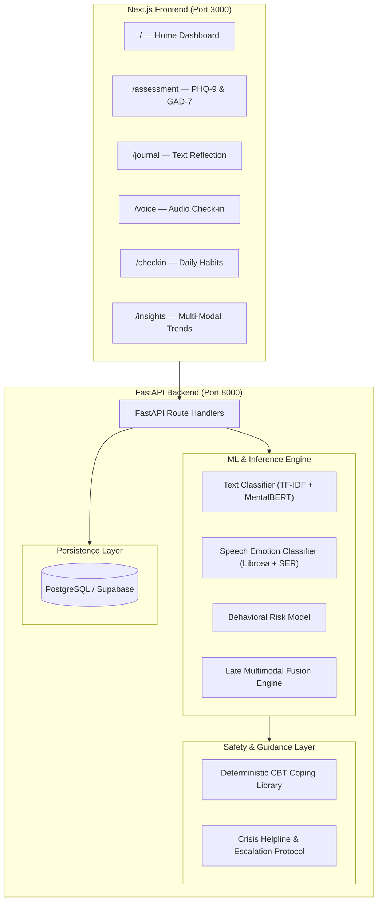

# EmoCare — Product & Technical Documentation

**Version:** 1.0.0  
**Status:** Active  
**Repository:** `EmoCare`  
**Frontend:** Next.js 16 (React 19 + TypeScript + Tailwind CSS)  
**Backend:** FastAPI + Uvicorn + PostgreSQL / Supabase  

---

## 1. Executive Summary

**EmoCare** is an affective-computing AI companion designed for the early detection, longitudinal tracking, and supportive management of emotional and mental health distress.

Unlike conventional mental health chatbots that rely on unconstrained generative text, EmoCare uses a **multi-modal machine learning pipeline** (combining text linguistics, voice acoustics, behavioral metrics, and standardized clinical screeners) paired with **deterministic, evidence-based Cognitive Behavioral Therapy (CBT) coping recommendations** and automated crisis safety triggers.

---

## 2. System Architecture



---

## 3. Core Modalities & Machine Learning Engine

### 3.1. Text Linguistic & Emotion Analysis
* **Route:** `POST /api/predict/text`
* **Input:** Raw text reflections and journal entries.
* **Extraction:**
  * **First-Person Pronoun Ratio:** Measures inward focus and self-referential rumination (`I`, `me`, `my`, `myself`).
  * **Absolutist Language Ratio:** Detects cognitive distortions and black-and-white thinking (`always`, `never`, `completely`, `must`).
  * **Negation Density:** Tracks negative valence markers (`not`, `no`, `never`, `cannot`).
* **Output:** Risk tier (`Low`, `Moderate`, `High`), prediction confidence, and probability distribution across tiers.

### 3.2. Speech Emotion Recognition (SER) & Prosodics
* **Route:** `POST /api/predict/speech`
* **Input:** Audio recordings (`.wav`, `.mp3`, `.ogg`, `.webm` up to 10 MB).
* **Extraction:**
  * **Acoustic Features:** 13–40 Mel-Frequency Cepstral Coefficients (MFCCs), Spectral Centroid, Zero-Crossing Rate.
  * **Prosodic Features:** Fundamental frequency ($F_0$) pitch variance, speech articulation rate, pause-to-speech ratio.
* **Output:** Classified emotion (*calm, happy, sad, angry, fearful, neutral, surprised*), emotion probability distribution, mapped risk tier, and acoustic summary.

### 3.3. Passive & Reported Behavioral Sensing
* **Route:** `POST /api/predict/behavioral`
* **Input:** Self-reported or wearable-synced metrics:
  * Sleep duration (hours) & sleep quality (1–5 scale)
  * Physical activity level & exercise minutes
  * Social interaction frequency (1–5 scale)
  * Daily subjective stress rating & mood rating
* **Output:** Behavioral risk tier and vulnerability score.

### 3.4. Late Decision-Level Multimodal Fusion
* **Route:** `POST /api/predict/multimodal`
* **Input:** Any combination of text, voice audio, and behavioral metrics.
* **Mechanism:**
  * Computes individual prediction vectors per modality.
  * Applies late weighted decision fusion with confidence normalization.
  * **Cross-Modal Agreement Score ($0.0 \to 1.0$):** Measures concordance among modalities. High discordance (e.g., cheerful text with flat/distressed vocal acoustics) flags a **low-confidence / mixed-signal warning**.
  * Outputs final risk classification, urgency level (`STABLE`, `WARNING`, `CRITICAL`), and human escalation indicators.

---

## 4. Standardized Clinical Screening Module

EmoCare integrates digital implementations of research-standard psychometric screeners:

### 4.1. PHQ-9 (Patient Health Questionnaire-9)
Assesses depression severity over the preceding two weeks (Score range: `0 – 27`):

| Total Score | Clinical Severity Band | App Risk Tier |
|---|---|---|
| **0 – 4** | Minimal or None | 🟢 Low |
| **5 – 9** | Mild Depression | 🟢 Low |
| **10 – 14** | Moderate Depression | 🟡 Moderate |
| **15 – 19** | Moderately Severe | 🔴 High |
| **20 – 27** | Severe Depression | 🔴 High |

### 4.2. GAD-7 (Generalized Anxiety Disorder-7)
Assesses anxiety and tension over the preceding two weeks (Score range: `0 – 21`):

| Total Score | Clinical Severity Band | App Risk Tier |
|---|---|---|
| **0 – 4** | Minimal Anxiety | 🟢 Low |
| **5 – 9** | Mild Anxiety | 🟢 Low |
| **10 – 14** | Moderate Anxiety | 🟡 Moderate |
| **15 – 21** | Severe Anxiety | 🔴 High |

* **Route:** `GET /api/assessment/questions/{test_type}` (Fetches questionnaire items and 4-point Likert scales: *0 - Not at all* to *3 - Nearly every day*).
* **Route:** `POST /api/assessment/submit` (Scores responses, logs results, returns severity band and interpretation).

---

## 5. Safety, Ethics & Crisis Escalation Protocols

> [!IMPORTANT]
> EmoCare is an affective-computing academic and supportive screening tool. It is **not** a diagnostic medical device.

### 5.1. Non-Hallucinatory CBT Coping Library
To guarantee clinical safety and eliminate generative AI hallucinations, recommendations are drawn from a deterministic, rule-based CBT catalog:
1. **Sensory Grounding:** 5-4-3-2-1 technique, somatic anchor exercises.
2. **Breathwork:** 4-4-4-4 Box breathing, diaphragmatic belly breathing.
3. **Cognitive Reframing:** Evidence testing, the "best-friend perspective" exercise.
4. **Behavioral Activation:** 10-minute micro-actions, scheduling pleasant daily events.

### 5.2. Crisis Hotlines & Critical Urgency
Whenever the system detects `CRITICAL` urgency, severe distress, or high-risk assessment scores, crisis helpline details are injected at the highest UI priority:
* **United States & Canada:** Suicide & Crisis Lifeline — **Dial or Text 988**
* **India:** iCall Psychosocial Helpline — **9152987821** / Vandrevala Foundation
* **United Kingdom:** Samaritans — **116 123**
* **Emergency Services:** **112 / 911 / 999**

---

## 6. Frontend Navigation & User Experience

| Route | Page | Purpose |
|---|---|---|
| [`/`](file:///d:/EmoCare/frontend/src/app/page.tsx) | **Home Dashboard** | High-level summary of baseline wellness, recent check-in stats, and quick actions |
| [`/assessment`](file:///d:/EmoCare/frontend/src/app/assessment/page.tsx) | **Self-Assessment** | PHQ-9 & GAD-7 questionnaire forms, automated scoring, and baseline calibration |
| [`/journal`](file:///d:/EmoCare/frontend/src/app/journal/page.tsx) | **Text Journal** | Guided reflective writing with instant linguistic and sentiment feedback |
| [`/voice`](file:///d:/EmoCare/frontend/src/app/voice/page.tsx) | **Voice Journal** | Live microphone recording, waveform display, acoustic feature extraction & emotion tags |
| [`/checkin`](file:///d:/EmoCare/frontend/src/app/checkin/page.tsx) | **Daily Check-in** | Slider-based logging for sleep, exercise, social activity, and mood |
| [`/insights`](file:///d:/EmoCare/frontend/src/app/insights/page.tsx) | **Multimodal Insights** | Integrated multimodal risk reports, cross-modal agreement score, and coping plans |

---

## 7. API Reference Summary

All API endpoints are documented with OpenAPI schemas at `http://localhost:8000/docs`.

### Key Endpoints:
```http
GET  /health
POST /api/predict/text
POST /api/predict/speech
POST /api/predict/behavioral
POST /api/predict/multimodal
GET  /api/assessment/questions/{test_type}
POST /api/assessment/submit
```

---

## 8. Development & Deployment Guide

### Prerequisites
* Python 3.10+
* Node.js 18+ (Node 20 recommended)
* Docker & Docker Compose (optional for containerized deployment)

### Local Startup

#### 1. Backend
```bash
cd backend
pip install -r requirements.txt
uvicorn app.main:app --reload --port 8000
```

#### 2. Frontend
```bash
cd frontend
npm install
npm run dev
```
Visit **`http://localhost:3000`** in your browser.

### Docker Deployment
```bash
docker compose -f docker/docker-compose.yml up --build
```
* **Frontend:** `http://localhost:3000`
* **API Backend:** `http://localhost:8000`
* **API Documentation:** `http://localhost:8000/docs`

---

## Therapy Engine (Phases 1-6)

### New API Endpoints (6 additional, total: 13)

| Method | Endpoint | Description |
|--------|----------|-------------|
| `POST` | `/api/therapy/session/start` | Start chat or voice session (returns prior summaries for continuity) |
| `POST` | `/api/therapy/session/end` | End session, generate & persist structured summary |
| `GET` | `/api/therapy/sessions/{user_id}` | List all user sessions |
| `GET` | `/api/therapy/session/{session_id}/messages` | Get session message history |
| `POST` | `/api/chat/message` | Chat therapy turn (text → safety gate → LLM → tools → reply) |
| `POST` | `/api/voice-therapy/interact` | Voice therapy turn (audio → STT + SER → safety gate → LLM → TTS) |

### Safety Architecture

EmoCare uses a **deterministic, zero-hallucination safety pipeline**:

```
User Input
    ↓
┌─────────────────────────────────┐
│  1. Pre-LLM Risk Classification  │ ← ML models classify BEFORE LLM sees input
│     Text: NLP risk model         │
│     Voice: SER acoustic model    │
└──────────┬──────────────────────┘
           ↓
    ┌──────┴──────┐
    │  Risk HIGH  │ → Deterministic crisis protocol (bypasses LLM entirely)
    │  or CRITICAL│   → Helpline numbers, grounding exercises, safety plan
    └──────┬──────┘
           │ Risk LOW/MODERATE
           ↓
┌─────────────────────────────────┐
│  2. Tool-Calling LLM (Claude)   │ ← Can ONLY invoke pre-defined CBT tools
│     Tools: thought_reframing,   │   Never generates clinical advice
│     grounding, behavioral_act,  │   Never paraphrases crisis language
│     mood_check, sleep_hygiene   │
└─────────────────────────────────┘
```

**Safety Rules:**
- **No generative clinical language**: Crisis responses are 100% deterministic templates
- **No hallucinated advice**: LLM can only call pre-defined tool functions
- **Pre-LLM classification**: Risk is assessed BEFORE the LLM sees the input
- **Dual-modal safety gate**: In voice mode, BOTH acoustic AND text risk must be safe

### Voice Therapy Pipeline

```
Audio → Whisper STT (transcription)
     → SER model (acoustic emotion: 8 classes)
     → Text risk classifier (on transcript)
     → Multimodal safety gate
     → Voice-mode LLM (no markdown, spoken cadence)
     → ElevenLabs TTS (calm preset) → Base64 audio
```

### CBT Tool Catalog

The LLM can only invoke these pre-defined deterministic tools:

| Tool | Input | Output |
|------|-------|--------|
| `thought_reframing` | `negative_thought` | Structured cognitive restructuring exercise |
| `grounding_exercise` | `exercise_type` | Step-by-step grounding technique (e.g., 5-4-3-2-1) |
| `behavioral_activation` | `activity_type` | Evidence-based activity suggestions |
| `mood_check` | `current_mood` | Mood tracking with validation |
| `sleep_hygiene` | `issue_type` | Sleep hygiene recommendations |

### Database Schema (Therapy)

```sql
therapy_sessions (id, user_id, mode, objective, started_at, ended_at)
therapy_messages (id, session_id, role, content, risk_tier, tools_used JSONB, timestamp)
session_summaries (id, session_id, user_id, summary_text, concerns JSONB, goals JSONB, techniques_used JSONB, created_at)
```

### New Frontend Pages

| Route | Description |
|-------|-------------|
| `/therapy/chat` | Chat therapy with session lifecycle, glassmorphic bubbles, tool badges, crisis banners |
| `/therapy/voice` | Voice therapy with mic recording, breathing aura animation, emotion detection cards, TTS playback |
| `/insights` (updated) | Added "Your Therapy Journey" section with session history timeline |

### New Environment Variables

| Variable | Required | Description |
|----------|----------|-------------|
| `ANTHROPIC_API_KEY` | For therapy | Claude API key for tool-calling LLM |
| `OPENAI_API_KEY` | For voice therapy | Whisper STT transcription |
| `ELEVENLABS_API_KEY` | For voice therapy | TTS spoken responses |
| `ELEVENLABS_VOICE_ID` | Optional | Voice ID (defaults to calm preset) |

> **Note**: All therapy API keys are optional — the system gracefully degrades with mock responses when keys are absent.

### Backend Files (New)

| File | Purpose |
|------|---------|
| `backend/app/db.py` | Extended with therapy tables + CRUD (sessions, messages, summaries) |
| `backend/app/therapy.py` | Safety interceptor + tool-calling LLM + session summarization |
| `backend/app/engine/__init__.py` | Engine module init |
| `backend/app/engine/llm_client.py` | Claude SDK + httpx fallback + 5 CBT tool definitions |
| `backend/app/engine/stt_client.py` | Whisper STT + mock fallback |
| `backend/app/engine/tts_client.py` | ElevenLabs TTS (calm preset) + graceful None fallback |
| `backend/app/engine/voice_therapy.py` | Full voice pipeline orchestration |

### Frontend Files (New/Modified)

| File | Purpose |
|------|---------|
| `frontend/src/types/api.ts` | Added 9 therapy TypeScript interfaces |
| `frontend/src/lib/api.ts` | Added 6 therapy API client functions |
| `frontend/src/app/therapy/chat/page.tsx` | Chat therapy page |
| `frontend/src/app/therapy/voice/page.tsx` | Voice therapy page |
| `frontend/src/app/globals.css` | Digital Sanctuary design system overhaul |
| `frontend/src/components/Navigation.tsx` | Added therapy nav links + mobile menu |
| `frontend/src/app/page.tsx` | Added therapy action cards to dashboard |
| `frontend/src/app/insights/page.tsx` | Added therapy journey section |
| `frontend/src/context/AuthContext.tsx` | Fixed prerender safety defaults |

### Test Results (35/35 passing)

- Phase 1: 10 tests — DB CRUD, schema validation, JSONB deserialization
- Phase 2: 12 tests — Safety interceptor, crisis protocol, CBT tool execution, zero hallucination
- Phase 3: 13 tests — STT/TTS clients, voice pipeline, all 13 API endpoints validation
