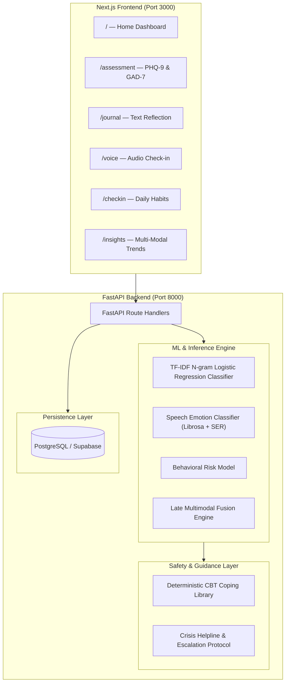

# EmoCare — Product & Technical Documentation

**Version:** 1.0.0  
**Status:** Active  
**Repository:** `EmoCare`  
**Frontend:** Next.js 16 (React 19 + TypeScript + Tailwind CSS)  
**Backend:** FastAPI + Uvicorn + PostgreSQL / Supabase  

---

## 1. Executive Summary

**EmoCare** is an affective-computing AI companion designed for the early detection, longitudinal tracking, and supportive management of emotional and mental health distress.

Unlike conventional mental health chatbots that rely on unconstrained generative text, EmoCare uses a **multi-modal machine learning pipeline** (combining text linguistics, voice acoustics, behavioral metrics, and standardized clinical screeners) paired with **deterministic, evidence-based Cognitive Behavioral Therapy (CBT) coping recommendations** and automated crisis safety triggers.

---

## 2. System Architecture



---

## 3. Core Modalities & Machine Learning Engine

### 3.1. Text Risk Analysis
* **Route:** `POST /api/predict/text`
* **Model:** TF-IDF N-gram Logistic Regression Classifier. The `text_mentalbert` artifact directory is a legacy name; the active route does not load MentalBERT or Bio_ClinicalBERT.
* **Input:** Raw text reflections and journal entries.
* **Extraction:** TF-IDF features plus first-person pronoun, absolutist-language, and negation-rate markers.
* **Decision policy:** High uses a 0.20 probability threshold or an acute-distress safety signal. Moderate uses a 0.35 threshold or a combined Moderate+High probability of at least 0.50. Explicit crisis handling remains separate from broader distress classification.
* **Output:** Risk tier (`Low`, `Moderate`, `High`), selected-tier confidence, raw model probability distribution, and linguistic markers.

### 3.2. Speech Emotion Recognition (SER) & Prosodics
* **Route:** `POST /api/predict/speech`
* **Training data:** RAVDESS + CREMA-D. DAIC-WOZ and IEMOCAP are pending acquisition and are not current training datasets.
* **Input:** Audio recordings (`.wav`, `.mp3`, `.ogg`, `.webm` up to 10 MB).
* **Extraction:** 95 model features comprising 40 MFCCs with mean and standard deviation, plus 15 pitch, energy, zero-crossing, spectral, chroma, duration, and pause features. Voice display prosodics are calculated separately.
* **Output:** Classified emotion (*angry, calm, disgust, fearful, happy, neutral, sad, surprised*), emotion probabilities, mapped risk tier, and acoustic summary.

### 3.3. Reported Behavioral Survey
* **Route:** `POST /api/predict/behavioral`
* **Input:** Self-reported sleep, sleep quality, activity, exercise, social interaction, stress, and mood values.
* **Mechanism:** Weighted lifestyle distress contributions mapped through softmax normalization. Survey answers are not padded into the StudentLife sensor model; that saved model is an inactive research artifact.
* **Output:** Behavioral risk tier and normalized risk probabilities.

### 3.4. Late Decision-Level Multimodal Fusion
* **Route:** `POST /api/predict/multimodal`
* **Input:** Any combination of text, voice audio, and behavioral metrics.
* **Mechanism:**
  * Computes predictions only for available modalities.
  * Uses each probability vector directly for a single modality. For multiple modalities, normalizes the text 0.45, speech 0.35, and behavioral 0.20 weights across available inputs.
  * Computes pairwise agreement across available modality tiers and flags low-confidence or mixed-signal results.
  * Outputs final risk classification, urgency (`STABLE`, `WARNING`, `CRITICAL`), and human escalation indicators.
  * Does not invoke the saved XGBoost fusion meta-classifier in the active route.

---

## 4. Standardized Clinical Screening Module

EmoCare integrates digital implementations of research-standard psychometric screeners:

### 4.1. PHQ-9 (Patient Health Questionnaire-9)
Assesses depression severity over the preceding two weeks (Score range: `0 – 27`):

| Total Score | Clinical Severity Band | App Risk Tier |
|---|---|---|
| **0 – 4** | Minimal or None | 🟢 Low |
| **5 – 9** | Mild Depression | 🟢 Low |
| **10 – 14** | Moderate Depression | 🟡 Moderate |
| **15 – 19** | Moderately Severe | 🔴 High |
| **20 – 27** | Severe Depression | 🔴 High |

### 4.2. GAD-7 (Generalized Anxiety Disorder-7)
Assesses anxiety and tension over the preceding two weeks (Score range: `0 – 21`):

| Total Score | Clinical Severity Band | App Risk Tier |
|---|---|---|
| **0 – 4** | Minimal Anxiety | 🟢 Low |
| **5 – 9** | Mild Anxiety | 🟢 Low |
| **10 – 14** | Moderate Anxiety | 🟡 Moderate |
| **15 – 21** | Severe Anxiety | 🔴 High |

* **Route:** `GET /api/assessment/questions/{test_type}` (Fetches questionnaire items and 4-point Likert scales: *0 - Not at all* to *3 - Nearly every day*).
* **Route:** `POST /api/assessment/submit` (Scores responses, logs results, returns severity band and interpretation).

---

## 5. Safety, Ethics & Crisis Escalation Protocols

> [!IMPORTANT]
> EmoCare is an affective-computing academic and supportive screening tool. It is **not** a diagnostic medical device.

### 5.1. Deterministic CBT Coping Library and Voice Gate
Structured recommendations come from a rule-based CBT catalog. Voice responses are limited to reflective listening or exact approved tool output, and unsafe generated clinical guidance is replaced before persistence and speech synthesis. These controls reduce generative safety risk without claiming to eliminate every possible error:
1. **Sensory Grounding:** 5-4-3-2-1 technique and contact-with-the-ground anchors.
2. **Breathwork:** 4-4-4-4 box breathing and diaphragmatic breathing.
3. **Cognitive Reframing:** Evidence testing and the best-friend perspective exercise.
4. **Behavioral Activation:** Small achievable activities and scheduling pleasant events.

### 5.2. Crisis Hotlines & Critical Urgency
Explicit crisis signals and qualifying assessment safety pathways can trigger crisis resources at high UI priority:
* **United States & Canada:** Suicide & Crisis Lifeline — **Dial or Text 988**
* **India:** iCall Psychosocial Helpline — **9152987821** / Vandrevala Foundation
* **United Kingdom:** Samaritans — **116 123**
* **Emergency Services:** **112 / 911 / 999**

---

## 6. Frontend Navigation & User Experience

| Route | Page | Purpose |
|---|---|---|
| [`/`](file:///d:/EmoCare/frontend/src/app/page.tsx) | **Home Dashboard** | High-level summary of baseline wellness, recent check-in stats, and quick actions |
| [`/assessment`](file:///d:/EmoCare/frontend/src/app/assessment/page.tsx) | **Self-Assessment** | PHQ-9 & GAD-7 questionnaire forms, automated scoring, and baseline calibration |
| [`/journal`](file:///d:/EmoCare/frontend/src/app/journal/page.tsx) | **Text Journal** | Guided reflective writing with instant linguistic and sentiment feedback |
| [`/voice`](file:///d:/EmoCare/frontend/src/app/voice/page.tsx) | **Voice Journal** | Live microphone recording, waveform display, acoustic feature extraction & emotion tags |
| [`/checkin`](file:///d:/EmoCare/frontend/src/app/checkin/page.tsx) | **Daily Check-in** | Slider-based logging for sleep, exercise, social activity, and mood |
| [`/insights`](file:///d:/EmoCare/frontend/src/app/insights/page.tsx) | **Multimodal Insights** | Integrated multimodal risk reports, cross-modal agreement score, and coping plans |

---

## 7. API Reference Summary

All API endpoints are documented with OpenAPI schemas at `http://localhost:8000/docs`.

### Key Endpoints:
```http
GET  /health
POST /api/predict/text
POST /api/predict/speech
POST /api/predict/behavioral
POST /api/predict/multimodal
GET  /api/assessment/questions/{test_type}
POST /api/assessment/submit
```

---

## 8. Development & Deployment Guide

### Prerequisites
* Python 3.10+
* Node.js 18+ (Node 20 recommended)
* Docker & Docker Compose (optional for containerized deployment)

### Local Startup

#### 1. Backend
```bash
cd backend
pip install -r requirements.txt
uvicorn app.main:app --reload --port 8000
```

#### 2. Frontend
```bash
cd frontend
npm install
npm run dev
```
Visit **`http://localhost:3000`** in your browser.

### Docker Deployment
```bash
docker compose -f docker/docker-compose.yml up --build
```
* **Frontend:** `http://localhost:3000`
* **API Backend:** `http://localhost:8000`
* **API Documentation:** `http://localhost:8000/docs`

---

## 9. Model Evaluation and Dataset Status

| Configuration | Accuracy | Macro F1 | High-Risk Recall | Status |
|---|---:|---:|---:|---|
| Text TF-IDF LogReg, original argmax | 0.7453 | 0.4805 | 0.2619 | Baseline before decision calibration |
| Speech MFCC XGBoost | 0.5070 | 0.4807 | 0.7439 | RAVDESS + CREMA-D baseline |
| StudentLife RF | 0.8200 | 0.7850 | 0.8500 | Inactive research artifact |

The previous perfect multimodal results were generated by a preliminary synthetic simulation and are retracted. No validated multimodal accuracy is currently claimed. The ablation reports use null values for those retracted metrics.

The calibrated text decision policy achieves 30/30 High classifications on the curated acute-distress regression statements in `tests/test_text_risk_recall.py`. This small safety regression set measures sensitivity only; it is not independent clinical validation and provides no specificity or overall-accuracy estimate.

## Therapy Engine

### API Endpoints and Ownership

| Method | Endpoint | Description |
|--------|----------|-------------|
| `POST` | `/api/auth/guest` | Issue a signed token for a new server-generated guest identity |
| `POST` | `/api/assessment/submit` | Score and persist an owned assessment |
| `GET` | `/api/assessment/history/{user_id}` | Retrieve owned assessment history |
| `POST` | `/api/therapy/session/start` | Start an owned chat or voice session |
| `POST` | `/api/therapy/session/end` | End an owned session and generate its summary |
| `GET` | `/api/therapy/sessions/{user_id}` | List owned sessions |
| `GET` | `/api/therapy/session/{session_id}/messages` | Read messages from an owned session |
| `POST` | `/api/chat/message` | Process a chat turn in an owned session |
| `POST` | `/api/voice-therapy/interact` | Process a voice turn in an owned session |
| `POST` | `/api/voice-therapy/greeting` | Generate a greeting in an owned session |

Clinical routes require a verified Supabase bearer token or signed guest token. Requested user IDs must match the token subject, and session IDs are checked against the session owner before reads or writes. Missing or invalid credentials return 401; ownership failures return 403.

### Safety Architecture

1. Text and acoustic risk analysis runs before normal LLM generation.
2. Explicit suicidal or self-harm crisis signals bypass normal generation and use deterministic crisis resources.
3. Other therapeutic conversations can use provider tool calling for structured CBT techniques and session context.
4. Voice output passes through response validation and a voice-specific safety gate. Registered CBT or crisis tool output replaces model-paraphrased guidance; unsafe clinical or instructional content becomes reflective listening.
5. The sanitized response is the exact text returned, persisted, and sent to ElevenLabs. These controls reduce risk but are not a guarantee against every possible error.

### Voice Therapy Pipeline

```
Audio → Whisper STT + acoustic SER
     → Calibrated text risk classification and explicit crisis gate
     → Reflective voice LLM with deterministic tools when appropriate
     → Response validation and voice safety sanitizer
     → Persist sanitized reply + ElevenLabs TTS → Base64 audio
```

### Deterministic Tool Catalog

| Tool | Input | Output |
|------|-------|--------|
| `get_cbt_coping_technique` | `category` | Exact entries from the registered CBT strategy library |
| `get_crisis_resources` | `region` | Deterministic crisis and emergency resources |
| `get_user_session_context` | `user_id` | Recent owned session summaries for conversation context |

### Database Schema (Therapy)

```sql
therapy_sessions (id, user_id, mode, started_at, ended_at, objective, session_state_columns)
therapy_messages (id, session_id, role, content, risk_tier, created_at)
session_summaries (id, session_id, user_id, summary_text, concerns, goals, techniques_used, created_at)
```

### Environment Variables

| Variable | Required | Description |
|----------|----------|-------------|
| `SUPABASE_URL` | For Supabase auth | Project URL used to derive issuer and JWKS location |
| `SUPABASE_JWT_SECRET` | Legacy HS256 auth | Supabase JWT secret; never exposed to the frontend |
| `SUPABASE_JWKS_URL` | Asymmetric auth | Optional explicit JWKS endpoint |
| `GUEST_SESSION_SECRET` | For guest access | Independent random secret of at least 32 bytes |
| `GROQ_API_KEY`, `OPENROUTER_API_KEY`, `ANTHROPIC_API_KEY`, `OPENAI_API_KEY` | Optional providers | LLM provider credentials |
| `ELEVENLABS_API_KEY` | For cloud TTS | Spoken voice responses |
| `ELEVENLABS_VOICE_ID` | Optional | Voice selection |

Provider keys are optional and use deterministic offline fallbacks where implemented. Authentication secrets have no insecure fallback.

### Relevant Backend Files

| File | Purpose |
|------|---------|
| `backend/app/auth.py` | JWT verification, guest tokens, and ownership helpers |
| `backend/app/safety.py` | Shared crisis and acute-distress text signals |
| `backend/app/db.py` | Therapy tables and CRUD |
| `backend/app/therapy.py` | Chat safety gate, session progression, and summaries |
| `backend/app/engine/llm_client.py` | Provider clients and deterministic tool calling |
| `backend/app/engine/voice_therapy.py` | Voice orchestration and final response safety gate |
| `frontend/src/lib/api.ts` | Bearer-token injection and verified user identity handling |

The offline test suite in `tests/` covers route authentication and IDOR resistance, assessment and therapy behavior, feature extraction, multimodal fusion, text-risk recall, and voice-response safety.
